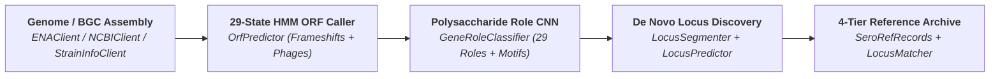

<div class="sv-hero" markdown>

# SeroRef

**De novo bacterial surface polysaccharide locus discovery, twilight-zone 1D-CNN gene role classification, hybrid MCL orthogroup clustering, and the 4-tier Strain–Assembly–Locus reference database.**

Built on [`seroverse.core`](https://github.com/SeroVerse/SeroVerse) zero-copy Structure-of-Arrays (SoA) containers and parallel Numba JIT kernels, **SeroRef** transforms raw bacterial or prophage genome assemblies into annotated polysaccharide biosynthetic gene clusters, orthogroup pan-graphs, and the curated [`SeroRefRecords`][seroref.db.records.SeroRefRecords] reference database (`src/seroref/data/seroref.npz`) in milliseconds — with zero external command-line dependencies (`minimap2`, `prodigal`, `mmseqs2`, or `diamond` are not required).

<div class="sv-badges">
  
  
  
  
  
  
</div>

</div>

---

## Core Innovations

<div class="grid cards" markdown>

-   :lucide-cpu: **Polysaccharide-Specific Dual-Head CNN (29 Roles + Phage Detection)**

    ---

    Surface antigen machinery (`Wzx` flippases, `Wzy` polymerases, `WaaL` ligases, and glycosyltransferases) routinely diverges below `20–25%` amino-acid identity where `BLAST`/`MMseqs2` fail. [`GeneRoleClassifier`][seroref.genes.cnn.GeneRoleClassifier] pairs multi-scale 1D convolutional motif filters (`k = 5, 9, 13 aa`; `DxD`, `ED`, `EX7E`, Rossmann loops) with dual `[conv_max, conv_avg]` pooling across **29 functional [`GeneRole`][seroref.genes.roles.GeneRole]s** (+ open-set `UNKNOWN` biological decoy rejection) and a joint **1-bit bacterial vs. bacteriophage/prophage origin head** (`predict_source` / `predict_source_proba`).

-   :lucide-waypoints: **De Novo Fragmented & MGE-Tolerant Locus Discovery**

    ---

    [`LocusPredictor`][seroref.loci.predictor.LocusPredictor] and [`LocusSegmenter`][seroref.loci.segmenter.LocusSegmenter] discover `CPS_WZY`, `CPS_ABC`, `CPS_SYNTHASE`, `LPS_WZY`, `LPS_ABC`, `EPS_PEL`, `EPS_PGA`, `EPS_ALGINATE`, `EPS_BCS`, and `TEICHOIC_ACID` loci *de novo* without a reference database — decoding frameshifted ORFs and `1-bp`/`4-bp` operon overlaps ([`OrfPredictor`][seroref.genes.orf.predictor.OrfPredictor]), bridging/healing `IS` transposase/integrase insertions (`heal_mobile_elements=True`), and stitching loci split across draft contigs (`stitch_contig_splits=True`).

-   :lucide-boxes: **Hybrid CNN-Rescued MCL & Pan-Locus Matching**

    ---

    [`LocusMatcher`][seroref.loci.matcher.LocusMatcher] and [`Loci.cluster_genes`][seroref.loci.models.Loci.cluster_genes] combine `seroverse.core` strobemer seeding, `MMSEQS12` reduced-alphabet $12^4$ CSR + ungapped BLOSUM62 diagonal prefiltering, SIMD-parallel Smith-Waterman-Gotoh, **role-gated CNN active-site motif rescue** (`conv_max` cosine similarity), and compiled **sparse Markov Clustering (MCL)** (`mode="mcl"`) with vectorized structural variant bitflag matching ([`MatchType`][seroref.loci.matcher.MatchType]).

-   :lucide-database: **4-Tier De Novo `SeroRefRecords` Reference Database**

    ---

    [`seroref.db`](reference/db.md) compiles the zero-pickle Structure-of-Arrays [`SeroRefRecords`][seroref.db.records.SeroRefRecords] reference archive (`src/seroref/data/seroref.npz`) across four de novo tiers: **ENA NCTC3000 (`PRJEB6403`)** PacBio reference assemblies, **DSMZ StrainInfo v2 & BacDive v2** culture-collection equivalence cliques (`strain_synonyms`), **NCBI Landmark BGC sweeps**, and **NCBI accession, PubMed `elink` & strain assembly resolution** — splitting multi-antigen formulas (`O1:K1:H7`) into one [`SeroRefRecord`][seroref.db.models.SeroRefRecord] per biological antigen locus.

</div>

---

## End-to-End Architecture



---

## Quickstart

=== "Load the Curated `SeroRefRecords` Database"

    ```python
    from seroref.db.records import SeroRefRecords
    from seroref.db.species import BacterialSpecies

    # Load the bundled relational Structure-of-Arrays reference database (.npz)
    db = SeroRefRecords.load()
    print(f"Loaded {len(db):,} de novo reference antigen loci across {len(db.strains):,} strains")

    # Filter by BacterialSpecies or derived antigen_type ('O-antigen', 'CPS', 'EPS', 'WTA')
    ecoli = db.where_species(BacterialSpecies.ESCHERICHIA_COLI)
    rec = ecoli[0]
    print(
        f"{rec.species.scientific_name_str} | serotype={rec.serotype.decode()} | "
        f"strain={rec.strain.decode()} | type={rec.antigen_type.decode()} | "
        f"archetype={rec.archetype.name}"
    )
    ```

=== "De Novo Locus Discovery (Intact, MGE-Disrupted & Fragmented)"

    ```python
    from seroverse.core.genome import GenomeAssembly
    from seroref.loci.predictor import LocusPredictor

    # Load a bacterial genome assembly (single chromosome or multi-contig draft FASTA)
    assembly = GenomeAssembly.from_fasta("genome.fasta")

    # Discover polysaccharide loci de novo, bridging IS elements and stitching contig splits
    predictor = LocusPredictor(stitch_contig_splits=True, heal_mobile_elements=False)
    loci = predictor.predict(assembly)

    for locus in loci:
        print(
            f"{locus.archetype.name}: {locus.start}..{locus.end} "
            f"({locus.num_genes} genes, completeness={locus.completeness:.2f}, "
            f"has_mge={locus.has_mge}, fragmented={locus.is_fragmented})"
        )
    ```

=== "Hybrid CNN-Rescued MCL Clustering & Reference Matching"

    ```python
    from seroref.loci.matcher import LocusMatcher
    from seroref.loci.models import GeneNode, Loci

    # Build a de novo locus matcher from discovered or curated Loci using hybrid MCL clustering
    raw_db = Loci.from_list(discovered_loci).canonicalize_strands()
    matcher = LocusMatcher(raw_db, cluster_mode="mcl", min_identity=80.0, min_coverage=0.80)

    # Compress the clustered Loci (GraphBatch) into a directed consensus pan-locus CSR graph
    pan_adj, pan_nodes, pan_counts = matcher.targets.as_pan_graph(node_mask=GeneNode.mask("ROLE_ID", "CLUSTER_ID"))

    # Match new de novo query loci against the database and inspect MatchType variant bitflags
    matches = matcher.match(query_loci)
    best = matches[0]
    print(f"Best match: {best.target_name} (score={best.score:.3f}, flags={best.match_type!r}, is_novel={best.is_novel})")
    ```

---

## Performance Summary

| Pipeline Stage | Engine | Throughput / Latency (`4.66 Mb` *E. coli* K-12) |
| :--- | :--- | :--- |
| **2-Bit DNA Encoding** | `Alphabet.DNA.encode` (`seroverse.core`) | **`0.38 ms`** (`12.2 GB/s` via Numba LUT) |
| **Ragged Protein Translation** | `GeneticCode.translate_ragged` (`seroverse.core`) | **`0.61 ms`** (`4,968` CDSs) |
| **29-State Frameshift-Aware ORFs (Global GC)** | [`OrfPredictor(local_gc_window=0)`][seroref.genes.orf.predictor.OrfPredictor] | **`59.6 ms`** (`78.1 Mb/s`) |
| **Single-Pass Sliding 4-kb Local GC ORFs** | [`OrfPredictor()`][seroref.genes.orf.predictor.OrfPredictor] | **`64.0 ms`** (`72.8 Mb/s`) |
